### Introduction

HDR Imaging is the go-to technique for capturing the full luminosity of real life scenes. Its basic idea is to capture a scene with multiple exposure times, and merge those frames using some weighting function. To do this merging, there are multiple algorithms, and in this blog post I will explain the specific method I chose to implement by Debevec and Malik [1].

Core of the merging algorithm is a nonlinear mapping called "Camera Response Curve". It's the relationship between the amount of light hitting the camera sensor and the brightness value of the pixel in final image. For HDR merging, this curve is needed, because the pixel values from different exposures are not directly proportional to the real scene luminosity. Finding the response curve and inverting it enables us to convert every exposure to a common space and merge the images properly.

### The Method

Each pixel value is a nonlinear function of exposure, $$Z_{ij} = f(E_i \Delta t_j)$$, where $$E_i$$ is the irradiance at pixel $$i$$ and $$\Delta t_j$$ is the exposure time of image $$j$$. Since $$f$$ is monotonic, we can define $$g = \ln f^{-1}$$, which gives:

$$
g(Z_{ij}) = \ln E_i + \ln \Delta t_j
$$

Pixel values are discrete, so $$g$$ only takes 256 values for 8-bit images. To find these values, Debevec and Malik model the solution to this problem as a least-squares optimization problem:

$$
\mathcal{O} = \sum_{i=1}^{N} \sum_{j=1}^{P} \left[ g(Z_{ij}) - \ln E_i - \ln \Delta t_j \right]^2 + \lambda \sum_{z=Z_{min}+1}^{Z_{max}-1} g''(z)^2
$$

The first term fits the data in least squares sense. The second term is added to keep $$g$$ smooth (it is needed to couple the $$g(z)$$ values in the minimization), and $$\lambda$$ weights the smoothness against data fitting term. Values close to $$0$$ and $$255$$ are noisy or saturated, so each term is also weighted with a hat function:

$$
w(z) =
\begin{cases}
z - Z_{min} & \text{for } z \le \tfrac{1}{2}(Z_{min} + Z_{max}) \\
Z_{max} - z & \text{for } z > \tfrac{1}{2}(Z_{min} + Z_{max})
\end{cases}
$$

Once $$g$$ is known, the radiance is a weighted average over all exposures:

$$
\ln E_i = \frac{\sum_{j=1}^{P} w(Z_{ij}) \left( g(Z_{ij}) - \ln \Delta t_j \right)}{\sum_{j=1}^{P} w(Z_{ij})}
$$

Once we know the radiance, we can build an HDR image that captures the full dynamic range of the scene.

### Implementation

I implemented the algorithm in Python using NumPy and OpenCV. I split the implementation into logical chunks, so that it is easier to debug and understand. The main steps are:

1. **Data Loading**: I first loaded the images and their corresponding exposure times. I used OpenCV to read the images and stored them in a list along with their exposure times.
2. **Data Sorting**: I then sorted the images by their filename number and assign doubling exposure times.
3. **Random Sampling of Pixels**: To do the HDR recovery, I randomly sampled pixel locations from loaded images. This step exists to keep the least squares optimization space small. Using every pixel to solve the system is computationally expensive, so I randomly sampled [50, 100, 300, 500, 1000] pixels in different experiments and tried to find the optimal one. Paper suggests picking the pixels by hand, but I viewed this as a limitation of the method so instead of perfectly replicating it, I decided to do this sweep. The results are displayed in later sections of this blog.
4. **Building the Z Table**: Once the pixel locations are sampled, I built a Z table that contains the pixel values for each sampled pixel across all exposures. This table is essential for solving the least squares problem, since it enables us to relate the pixel values to the exposure times and the unknown camera response function.
5. **Solving for the Camera Response Function**: I then solved the least squares problem per channel to find the camera response function $$g_{c}$$. I used NumPy's linear algebra functions (`np.linalg.lstsq` specifically to solve the least squares problem) to solve the system of equations derived from the optimization problem. The smoothness term was incorporated into the system to ensure that the resulting function is smooth. For the smoothness term $$\lambda$$, I experimented with values [1, 10, 50, 100, 500] and tried to find the optimal one. The results are displayed in later sections of this blog.
6. **Merging the HDR Image**: Finally, I merged the HDR image by combining the radiance values with the camera response function to create a high dynamic range image that captures the full dynamic range of the scene.

### Difficulties I Faced

The first problem I faced was with the numerical precision. The pixel values in the Z table (the table that contains the pixel values for each sampled pixel across all exposures) are of type uint8, but arithmetic operations on them wrap around when they exceed 255. This caused issues when calculating the weights and the least squares optimization. To fix this, I converted the pixel values to int32 before performing any arithmetic operations. Similarly, during the solving of the optimization problem, I had to convert float32 to float64 to avoid precision issues.

The second problem was with the vectorization of the merging algorithm (which is equation 6 in the paper). My initial implementation looped over every pixel, frame, and channel which was extremely slow that I had to close the program after 10 minutes of running. I then decided to loop over frames, index g and w with the whole HxW channel at once, and add the results into HxW numerator and denominator arrays. This was a huge speedup, and the program ran in a few seconds instead of minutes.

### Validation of the Implementation Using the Virtual Camera

In order to validate my implementation, I used the given virtual camera frames. Those frames are generated from a known camera response function, so I can compare the recovered response function with the ground truth. I used the same random sampling of pixels and smoothness parameter as in my previous experiments, and the results are shown in the figure below. The recovered response function closely matches the ground truth.

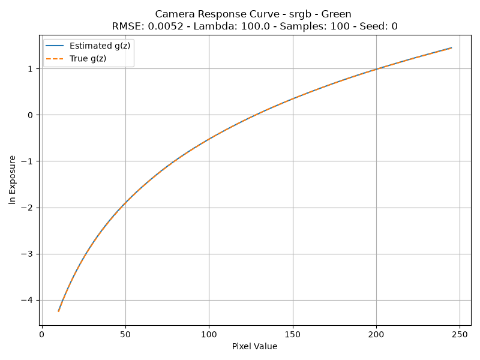

**Figure 1:** *Recovered Camera Response Function vs Ground Truth for sRGB virtual camera (green channel only)*

I used the virtual camera frames to sweep the parameters N and $$\lambda$$ to find the optimal values. The results are shown in the figure below. The values I chose to use are N=100 and $$\lambda$$ = 100, which gives reasonable RMSE values across different virtual cameras. It's the best combination on linear virtual camera, and the second best on sRGB virtual camera, and close to the best on mildly noisy virtual cameras.

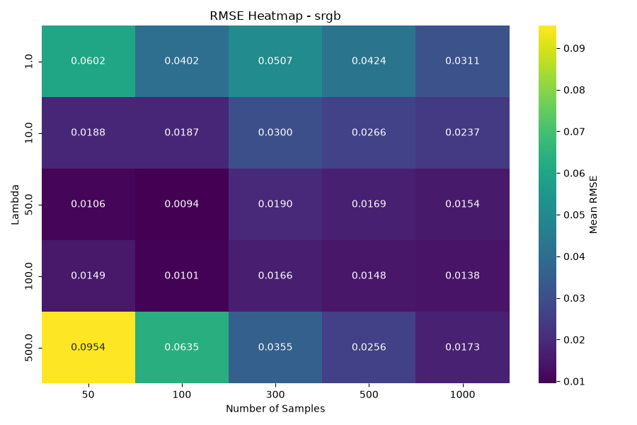

**Figure 2:** *Optimal Parameters for sRGB virtual camera*

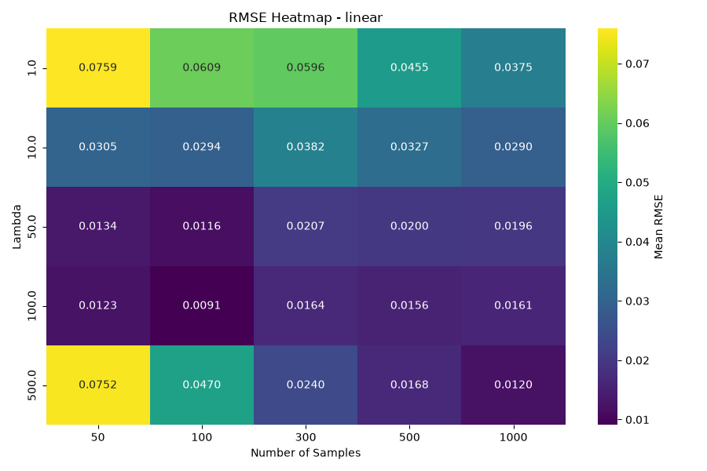

**Figure 3:** *Optimal Parameters for linear virtual camera*

There are other virtual camera settings with noise included, and the smoothness parameter $$\lambda$$ is more important in those cases. The optimal $$\lambda$$ for the more noisy virtual camera setting is $$\lambda$$ = 500 which gives the best match with the ground truth camera response function measured by RMSE.

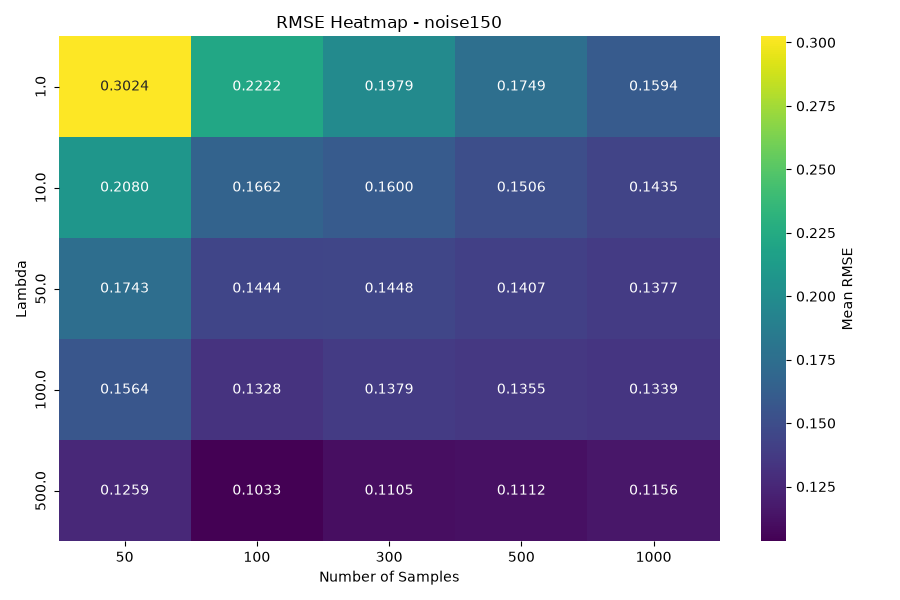

**Figure 4:** *Optimal Parameters for noisy virtual camera*

### Running Time of the Implementation

The algorithm has several different parts with different computational complexities. To show this effect, I conducted my speed analyses in two ways.
(All speed computations were done on my laptop with an Apple M3 CPU and 16GB RAM.)

Firstly, I measured where the compute time goes per sequence. Here I fixed the settings and investigated how image size and frame count affect each stage of the algorithm. The results are shown in the table below. These runs used $$\lambda = 100$$ and $$N = 100$$, and the build/solve times are given per channel. HDR merge is the time it takes to merge the HDR image after the camera response function is found. The results show that the solve time depends only on the frame count while load and merge scale with pixel and frame count. The build/solve times are relatively small compared to the HDR merge time.

**Table 1:** *Running time per sequence with λ = 100 and N = 100. Build and solve times are per channel.*

| Sequence | Resolution | Frames | Load (ms) | Build system (ms) | Solve (ms) | HDR merge (ms) |
| --- | --- | --- | --- | --- | --- | --- |
| Canon EOS 550D | 5184×3456 | 9 | 470 | 0.62 | 16.1 | 2958 |
| Minolta DiMAGE A1 | 1600×1200 | 13 | 106 | 0.85 | 19.5 | 300 |
| Nikon Coolpix E5400 | 2592×1944 | 16 | 159 | 1.03 | 22.2 | 1035 |
| Nikon D2H | 2464×1632 | 9 | 136 | 0.64 | 16.1 | 509 |
| Virtual sRGB | 1024×1024 | 9 | 21 | 0.55 | 15.9 | 141 |

Secondly, I measured how the solve time scales with the number of sampled pixels N. The results are shown in the table below. I used 9 frames (the virtual camera frames), averaged over 5 sequences, and swept the run with 5 $$\lambda$$ × 5 seeds to make the averaging fair. The build/solve times are given per channel. As seen from the table, build time scales linearly with N, while solve time scales quadratically with N on the high end. The results show that the algorithm is efficient for small N, but becomes computationally expensive for larger N.

**Table 2:** *Build and solve time against the number of sampled pixels N, per channel, averaged over the five 9-frame virtual sequences, 5 λ values and 5 seeds.*

| N | System size (equations × unknowns) | Build system (ms) | Solve (ms) |
| --- | --- | --- | --- |
| 50 | 705 × 306 | 0.32 | 9.8 |
| 100 | 1155 × 356 | 0.56 | 15.9 |
| 300 | 2955 × 556 | 1.67 | 56.1 |
| 500 | 4755 × 756 | 3.01 | 126.9 |
| 1000 | 9255 × 1256 | 7.55 | 498.9 |

### Response Curves of Real Cameras and Merge Results

Here are the recovered response curves of the given real camera sequences. Since the internals of these cameras are not known, I could not do a sweep to find the optimal $$\lambda$$ and $$N$$ values with RMSE, so I used the swept values from virtual camera sequences which happened to be $$\lambda = 100$$ and $$N = 100$$. The curves are shown for each camera.

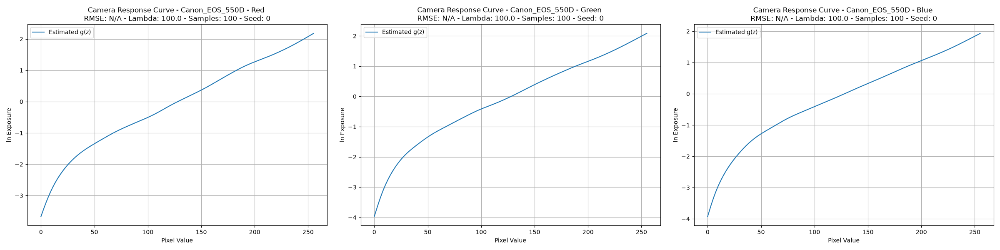

**Figure 5:** *Recovered Camera Response Function for Canon EOS 550D*

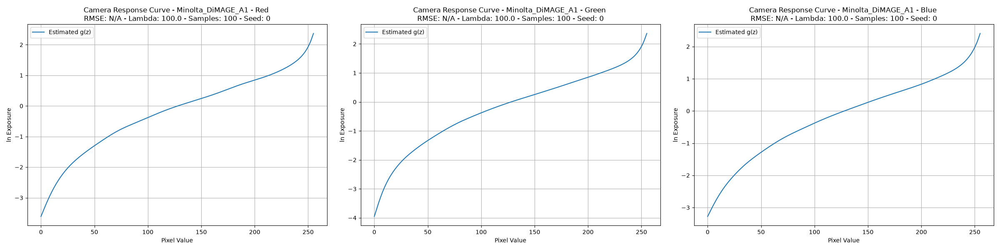

**Figure 6:** *Recovered Camera Response Function for Minolta DiMAGE A1*

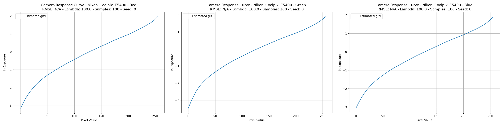

**Figure 7:** *Recovered Camera Response Function for Nikon Coolpix E5400*

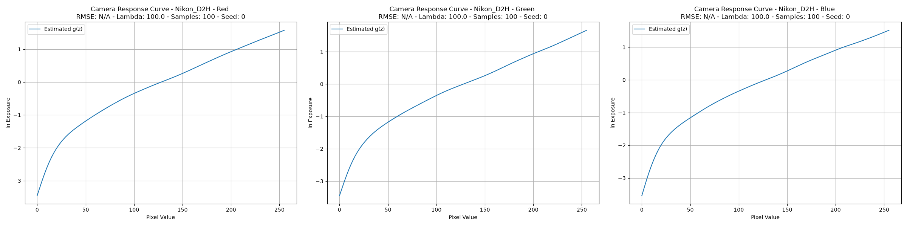

**Figure 8:** *Recovered Camera Response Function for Nikon D2H*

Also, to show the effect of $$\lambda$$, here I include one camera's red channel curve for $$\lambda = 10$$ and $$\lambda = 100$$. As seen from the figures, larger $$\lambda$$ values produce smoother curves.

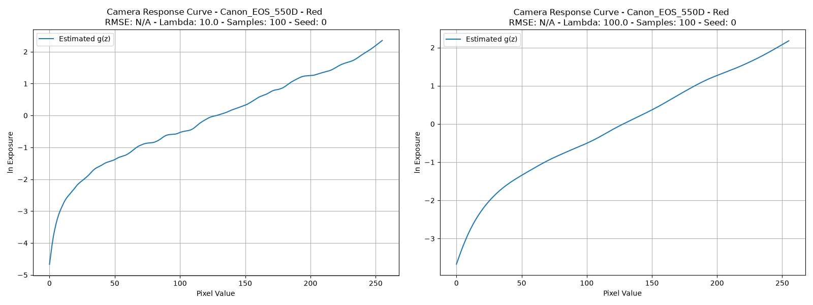

**Figure 9:** *Recovered Camera Response Function for Canon EOS 550D with different smoothness parameters*

### Recovered HDR Images

Since the final output of the algorithm is an HDR image, I also include the recovered HDR images for each camera sequence here. For reference, I compare the recovered HDR images with the images with highest and lowest exposure times. To display the HDR images in this blog, I used the app *bracket* by our instructor Ahmet Oğuz Akyüz. I tonemapped the `.hdr` images with the default $$\gamma = 2.2$$ value.

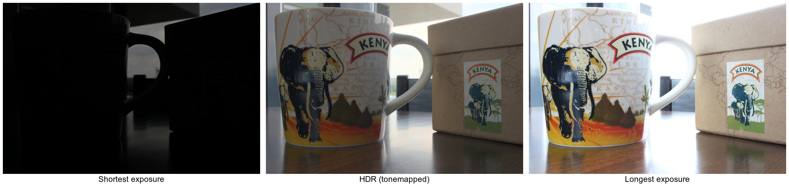

**Figure 10:** *Recovered HDR Image for Canon EOS 550D*

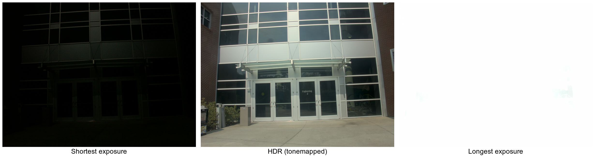

**Figure 11:** *Recovered HDR Image for Minolta DiMAGE A1*

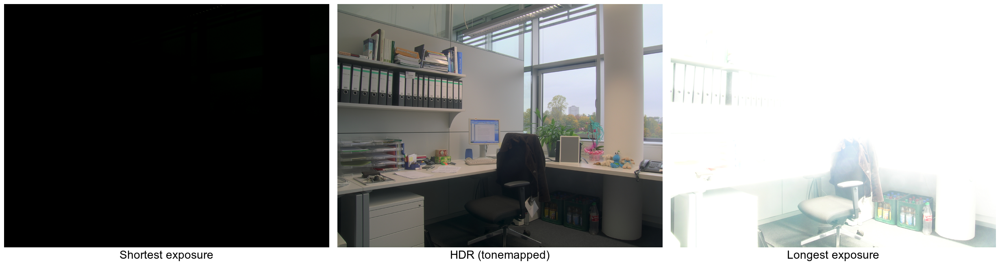

**Figure 12:** *Recovered HDR Image for Nikon Coolpix E5400*

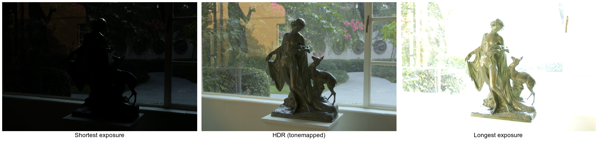

**Figure 13:** *Recovered HDR Image for Nikon D2H*

The results look visually pleasing to me. Scenes were static so there are no ghosting artifacts, so there was no need for a complex deghosting algorithm. The recovered HDR images capture the full dynamic range of the scenes, and the details in both the shadows and highlights are preserved. These results show that my implementation works as expected.

### Response Curve of my iPhone 15 and created HDR Images

Required by the homework, I downloaded a camera application called ProCamera, stabilized my camera and took multiple pictures with increasing exposure values in front of our department. My goal was to use those frames to estimate the response curve for my phone camera. iOS does not allow users to capture in manual mode with the default camera app, so I needed a third-party app to set the exposure time directly. I fixed the ISO value to 100, and took 12 images with increasing exposure values [1/2000, 1/1000, 1/500, 1/250, 1/125, 1/60, 1/30, 1/15, 1/8, 1/4, 1/2, 1]. Below are several example frames at different exposure values.

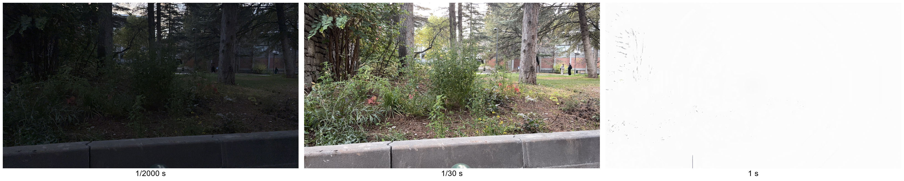

**Figure 14:** *Three different exposure valued photographs at ISO 100*

To convert the HEIC images to JPEG format, I used the builtin MacOS tool **sips**. The algorithm only needs the ratios between exposure times, not their absolute values, because a constant scale factor just shifts $$\ln E$$ up or down. So I assumed the exposure time doubled with each frame. I validated this by checking that EXIF values deviate from exact doubling by at most 5.4%, which is acceptable for this experiment.

I then used the exposure times and the images to recover the response curve for my iPhone 15 camera. The recovered response curves per channel are shown below.

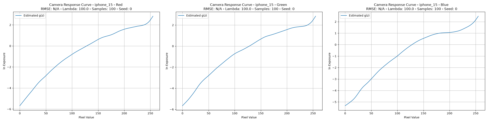

**Figure 15:** *Recovered Camera Response Function for iPhone 15 shown per channel*

Finally, I merged the HDR image using the recovered response curve and the input images. The resulting HDR image is shown below. The HDR image captures the full dynamic range of the scene. However, due to the impossibility of people not walking around CENG building, there are several ghosting artifacts. Since deghosting methods are not in the scope of this homework, I did not attempt to remove them.

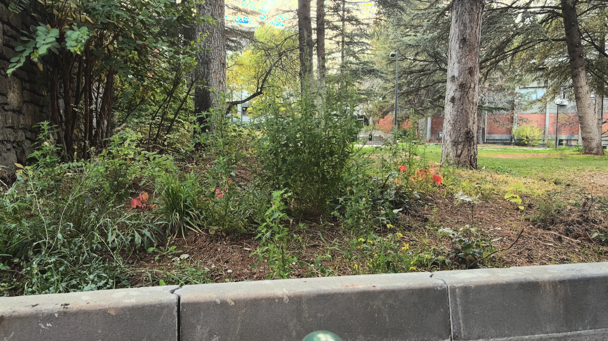

**Figure 16:** *Merged HDR image.*

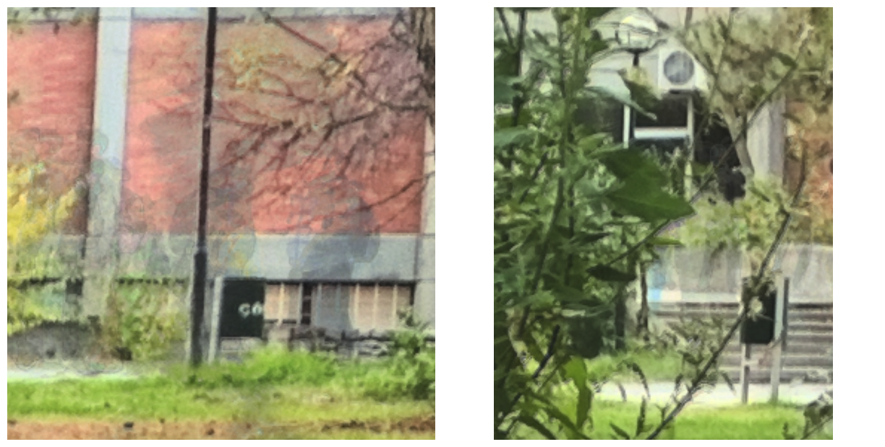

**Figure 17:** *Ghosting artifacts caused by motion in the scene even though the camera was static.*

### Comparison of Recovered Response Curves

Finally, I compared the recovered response curves of my iPhone 15 camera with other camera response curves. Nikon Coolpix E5400 and Minolta DiMAGE A1 cameras show a visible elbow at the end of the curve, which is similar to my iPhone 15 camera. Nikon D2H and Canon EOS 550D cameras have a nearly straight curve. This shows that different cameras have different response curves, and it is important to recover the response curve for each camera in order to merge HDR images properly.

Another thing I noticed is that iPhone 15 camera's response curve covers a much wider range than the other cameras, probably due to a better sensor and iOS tone processing.

### Conclusion

In this blog post, I tried to explain how I implemented the HDR merging algorithm by Debevec and Malik. I explained the method, the implementation details, the difficulties I faced and how I validated my implementation using virtual camera frames. I also showed the recovered response curves and HDR images for real camera sequences and my iPhone 15 camera. Overall, I am satisfied with my algorithm implementation and the results it produced. One future work includes adding a deghosting algorithm to remove the ghosting artifacts in the final HDR images.

## References

[1] Debevec, P. E., & Malik, J. (1997). Recovering High Dynamic Range Radiance Maps From Photographs. In Proceedings of the 24th annual conference on Computer graphics and interactive techniques (pp. 369-378).

## APPENDIX

### How to Run the Code

#### Setup

To run the code, you need to have Python 3.12 installed on your system. You also need to install the required libraries, which are listed in the `requirements.txt` file. You can install them using pip:

```bash
pip install -r requirements.txt
```

Everything is run from the hw1/ folder because the scripts are written to use relative paths.

#### Data Layout

The provided sequences are in `exposure_sequences/<camera>` and `exposure_sequences/virtual_camera/<set>` folders with frames named from 0 to N-1 in darkest-first order. iPhone frames are in `exposure_sequences/iphone_15/` as 0.jpg to 11.jpg, converted from HEIC with sips. Original HEIC files are kept next to them. Every sequence is processed with the doubling exposure times assumption, and the results are saved in `results/<camera>` folders. The virtual camera frames are used to sweep the parameters N and $$\lambda$$ to find the optimal values, and the results are saved in `results/analysis` folder.

#### Commands to Use in Order

1. `bash run_all_sequences.sh` runs the algorithm on all sequences with $$\lambda = 10, N = 100$$ on all 10 provided sequences. `bash run_all_sequences.sh --sweeps` also runs the full $$\lambda \times N \times$$ seed sweep on the 6 virtual sets. This sweep is used to calibrate the parameters for the real camera sequences.

2. `python measurements.py` reads the experiment results and writes the tables and figures to the results/analysis folder.

3. `bash run_real_sequences.sh` runs the algorithm on all real camera sequences with the chosen parameters found from the virtual camera sweeps ($$\lambda = 100, N = 100$$). The results are saved in `results/<camera>` folders.

4. `bash run_hdr_construction.sh` merges the 4 real cameras into `.hdr` files in `results/<camera>` folders.

#### Single Runs for Response Curve Plots and iPhone 15 results

`python debevec.py --seq_dir <folder> --lmbda 100 --num_samples 100 --seed 0` generates the response curve plots, and `python hdr.py --seq_dir <folder> --lmbda 100 --num_samples 100 --seed 0` makes the HDR image for the given sequence.

Tonemapping of the HDR images is done with the bracket app by Ahmet Oğuz Akyüz, which is a very useful tool for visualizing HDR images. The tonemapped images are saved in `results/<camera>/tonemapped.jpg` files. The combined figures used in the blogpost are simply made by combining the individual figures with the Preview app on MacOS.
